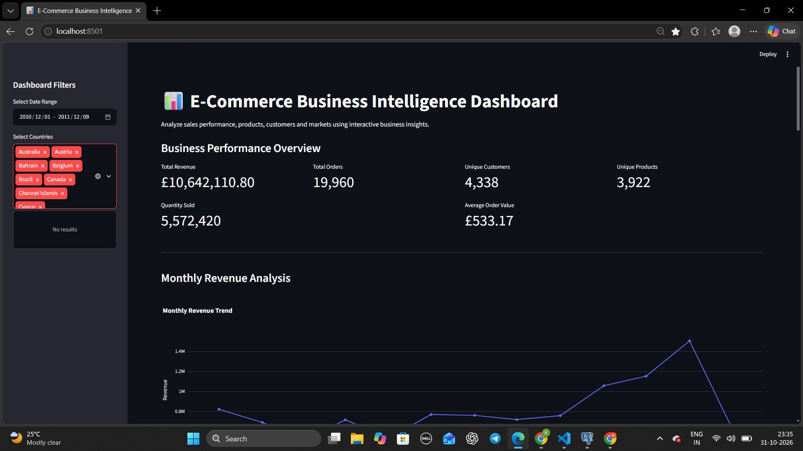

# E-Commerce Business Intelligence & Sales Analytics

An end-to-end data analytics project that transforms retail transaction data into actionable business insights using Python, SQL, PostgreSQL and Streamlit.

## Project Overview

This project analyzes an online retail dataset containing more than 500,000 transaction records.

It covers data cleaning, exploratory data analysis, SQL-based business analysis and an interactive dashboard to understand revenue trends, product performance, customer behavior and country-wise sales.

## Dashboard Preview



## Business Objectives

- Analyze overall sales and revenue performance.
- Identify top-performing products.
- Understand country-wise revenue contribution.
- Analyze customer purchasing behavior.
- Identify repeat customers.
- Discover monthly revenue trends and growth.
- Understand daily and hourly sales patterns.

## Key Performance Indicators

| Metric | Result |
|---|---:|
| Total Revenue | £10,642,110.80 |
| Total Orders | 19,960 |
| Unique Customers | 4,338 |
| Unique Products | 3,922 |
| Quantity Sold | 5,572,420 |
| Average Order Value | £533.17 |

*These figures reflect the cleaned dataset and the full reporting period.*

## Technologies Used

- Python
- Pandas and NumPy
- PostgreSQL
- SQL
- SQLAlchemy
- Streamlit
- Plotly
- Git and GitHub

## Project Workflow

1. Data Collection — Downloaded the Online Retail dataset.
2. Data Cleaning — Removed duplicate records, cancelled invoices and invalid transactions.
3. Feature Engineering — Created revenue, year, month, day and hour features.
4. Exploratory Data Analysis — Analyzed sales, products, countries and customers.
5. SQL Analysis — Developed business queries using aggregations, CTEs and window functions.
6. Dashboard Development — Built an interactive Streamlit dashboard.

## Project Structure

```text
ecommerce-business-intelligence/
│
├── app/
│   └── dashboard.py
│
├── dashboard/
│   └── screenshots/
│
├── data/
│   ├── raw/
│   └── processed/
│
├── reports/
│   ├── figures/
│   └── summaries/
│
├── sql/
│   └── phase4_business_analysis.sql
│
├── src/
│   ├── check_dataset.py
│   ├── explore_data.py
│   ├── clean_data.py
│   ├── verify_clean_data.py
│   ├── eda_analysis.py
│   └── load_to_postgres.py
│
├── .gitignore
├── requirements.txt
└── README.md
```

## Dataset

Source: UCI Machine Learning Repository — Online Retail

https://archive.ics.uci.edu/dataset/352/online+retail

The dataset contains transactions from a UK-based online retailer between 2010 and 2011.

Download the Excel dataset and save it as:

`data/raw/Online Retail.xlsx`

## Installation and Setup

### 1. Clone the repository

```bash
git clone YOUR_GITHUB_REPOSITORY_URL
cd ecommerce-business-intelligence
```

### 2. Create a virtual environment

```bash
python -m venv .venv
```

Activate it on Windows CMD:

```cmd
.venv\Scripts\activate.bat
```

### 3. Install dependencies

```bash
pip install -r requirements.txt
```

### 4. Download the dataset

Download the Online Retail Excel dataset from the UCI link above and place it in `data/raw/`.

### 5. Configure PostgreSQL

Create a PostgreSQL database named `ecommerce_db`.

Create `.streamlit/secrets.toml` with your local PostgreSQL connection settings:

```toml
[postgres]
host = "localhost"
port = 5432
database = "ecommerce_db"
user = "postgres"
password = "YOUR_POSTGRES_PASSWORD"
```

Never commit this secrets file to GitHub.

### 6. Run the data preparation scripts

```cmd
python src/check_dataset.py
python src/explore_data.py
python src/clean_data.py
python src/verify_clean_data.py
python src/eda_analysis.py
python src/load_to_postgres.py
```

### 7. Run the dashboard

```cmd
streamlit run app/dashboard.py
```

Open the local URL provided by Streamlit, normally:

`http://localhost:8501`

## SQL Analysis

The project includes business queries covering:

- Overall business performance
- Monthly revenue analysis
- Top products by revenue
- Country-wise sales
- Top customers
- Repeat customer analysis
- Month-over-month revenue growth
- Weekday sales analysis
- Peak shopping hours
- Customer revenue ranking

See `sql/phase4_business_analysis.sql`.

## Future Improvements

- Cloud database integration
- Public dashboard deployment
- Customer segmentation using RFM analysis
- Sales forecasting
- Product recommendation analysis
- Automated data refresh

## Author

Developed as a portfolio project to demonstrate practical data analytics, SQL, Python and business intelligence skills.
